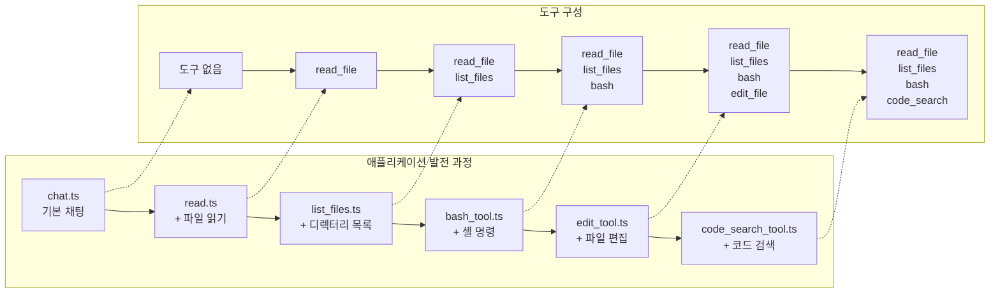
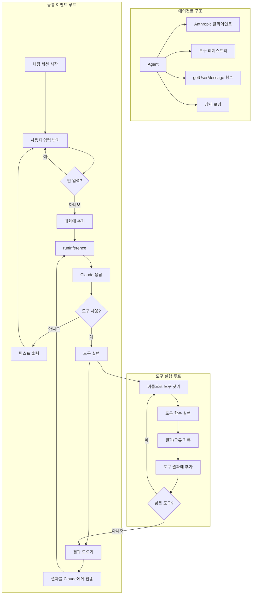

# 🧠 단계별 워크샵으로 나만의 코딩 에이전트 만들기

환영합니다! 👋 이 워크샵에서는 **AI 기반 코딩 어시스턴트**를 직접 만들어 봅니다. 기본 챗봇에서 시작해서 파일 읽기, 셸 명령 실행, 코드 검색 같은 강력한 도구를 하나씩 붙여 나가요.

AI 전문가가 아니어도 괜찮아요. 한 단계씩 따라 만들기만 하면 됩니다!

🌐 **자세한 개요가 궁금하다면?** 블로그 글을 확인해 보세요: [ghuntley.com/agent](https://ghuntley.com/agent/)

> 🟦 **TypeScript 버전.** 이 저장소는 Go로 작성된 [ghuntley/how-to-build-a-coding-agent](https://github.com/ghuntley/how-to-build-a-coding-agent)를 TypeScript로 옮긴 것입니다. 언어만 바뀌었고, 다루는 개념과 만드는 6개의 에이전트, 학습 목표는 같아요.
>
> 🇺🇸 English: [README.en.md](README.en.md)

---

## 🎯 배울 내용

워크샵을 마치면 다음을 이해하게 됩니다:

- ✅ Anthropic Claude API에 연결하는 방법
- ✅ 간단한 AI 챗봇을 만드는 방법
- ✅ 파일 읽기, 코드 편집, 명령 실행 같은 도구를 추가하는 방법
- ✅ 도구 요청과 오류를 처리하는 방법
- ✅ 단계마다 더 똑똑해지는 에이전트를 만드는 방법

---

## 🛠️ 만들게 될 것

코딩 어시스턴트를 6개 버전으로 만들어요.

버전마다 기능이 하나씩 늘어납니다:

1. **기본 채팅** — Claude와 대화하기
2. **파일 리더** — 코드 파일 읽기
3. **파일 탐색기** — 폴더 안의 파일 나열하기
4. **명령 실행기** — 셸 명령 실행하기
5. **파일 편집기** — 파일 수정하기
6. **코드 검색** — 패턴으로 코드베이스 검색하기



마지막에는 로컬에서 쓰는 강력한 개발 어시스턴트가 완성됩니다!


---

## 🧱 동작 방식 (아키텍처)

각 에이전트는 이렇게 동작해요:

1. 사용자의 입력을 기다립니다
2. 입력을 Claude에게 보냅니다
3. Claude는 바로 답하거나 도구 사용을 요청합니다
4. 에이전트가 도구를 실행합니다 (예: 파일 읽기)
5. 결과를 Claude에게 돌려보냅니다
6. Claude가 최종 답변을 줍니다

이것을 **이벤트 루프**라고 불러요 — 에이전트의 심장 박동 같은 거죠.



## 🚀 시작하기

### ✅ 준비물

* Node.js 22 이상 또는 [devenv](https://devenv.sh/) (간편한 설정을 위해 권장)
* [Anthropic API 키](https://platform.claude.com/settings/keys)

### 🔧 환경 설정

**방법 1: 권장 (devenv 사용)**

```bash
devenv shell  # 필요한 것을 모두 불러옵니다
```

**방법 2: 수동 설정**

```bash
# Node.js가 설치되어 있는지 확인하세요
npm install
```

### 🔐 API 키 추가

```bash
export ANTHROPIC_API_KEY="your-api-key-here"
```

---

## 🏁 기본부터 시작하기

### 1. `chat.ts` — 기본 채팅

Claude와 대화하는 간단한 챗봇이에요.

```bash
npx tsx chat.ts
```

* ➡️ 해 보기: “안녕!”
* ➡️ `--verbose`를 붙이면 상세 로그를 볼 수 있어요

> 💡 [`tsx`](https://tsx.is)는 빌드 단계 없이 TypeScript 파일을 바로 실행해요. Node.js 22.18 이상에서는 `node chat.ts`도 동작합니다.

---

## 🛠️ 도구 추가하기 (한 번에 하나씩)

### 2. `read.ts` — 파일 읽기

이제 Claude가 컴퓨터의 파일을 읽을 수 있어요.

```bash
npx tsx read.ts
```

* ➡️ 해 보기: “fizzbuzz.js 읽어 줘”

---

### 3. `list_files.ts` — 폴더 둘러보기

Claude가 디렉터리를 둘러볼 수 있게 해 줍니다.

```bash
npx tsx list_files.ts
```

* ➡️ 해 보기: “이 폴더에 있는 파일을 모두 보여 줘”
* ➡️ 해 보기: “fizzbuzz.js에 뭐가 들어 있어?”

---

### 4. `bash_tool.ts` — 셸 명령 실행

Claude가 안전한 터미널 명령을 실행할 수 있게 해 줍니다.

```bash
npx tsx bash_tool.ts
```

* ➡️ 해 보기: “git status 실행해 줘”
* ➡️ 해 보기: “bash로 .ts 파일을 모두 나열해 줘”

---

### 5. `edit_tool.ts` — 파일 편집

이제 Claude가 **코드를 수정**하고, 파일을 만들고, 변경할 수 있어요.

```bash
npx tsx edit_tool.ts
```

* ➡️ 해 보기: “Python hello world 스크립트를 만들어 줘”
* ➡️ 해 보기: “fizzbuzz.js 맨 위에 주석을 추가해 줘”

---

### 6. `code_search_tool.ts` — 코드 검색

패턴 검색을 사용합니다 ([ripgrep](https://github.com/BurntSushi/ripgrep) 기반).

```bash
npx tsx code_search_tool.ts
```

* ➡️ 해 보기: “TypeScript 파일에서 함수 정의를 모두 찾아 줘”
* ➡️ 해 보기: “TODO 주석을 검색해 줘”

---

## 🧪 샘플 파일 (기본 포함)

1. `fizzbuzz.js`: 파일 읽기와 편집 실습용
1. `riddle.txt`: 살펴볼 만한 재미있는 텍스트 파일
1. `AGENT.md`: 프로젝트 환경 정보

---

## 🐞 문제 해결

**API 키가 동작하지 않나요?**

* export되어 있는지 확인하세요: `echo $ANTHROPIC_API_KEY`
* [Anthropic 대시보드](https://www.anthropic.com)에서 사용 한도를 확인하세요

**TypeScript 오류가 나나요?**

* `npm install`을 실행하세요
* Node.js 22 이상을 쓰고 있는지 확인하세요
* `npm run check`로 모든 단계를 타입 검사하세요

**도구 오류가 나나요?**

* `--verbose`로 전체 오류 로그를 확인하세요
* 파일 경로와 권한을 확인하세요

**환경 문제가 있나요?**

* `devenv shell`을 사용하면 설정 문제를 피할 수 있어요

---

## 💡 도구의 동작 원리 (내부 구조)

도구는 플러그인 같은 거예요. 다음 세 가지를 정의합니다:

* **이름** (예: `read_file`)
* **입력 스키마** (도구에 필요한 정보)
* **함수** (도구가 하는 일)

TypeScript로 정의한 도구 예시:

```typescript
const ReadFileDefinition: ToolDefinition = {
  name: "read_file",
  description: "Reads the contents of a file",
  inputSchema: generateSchema(ReadFileInput),
  function: readFile,
};
```

스키마는 [Zod](https://zod.dev) 스키마로 생성하기 때문에 정의하고 재사용하기 쉬워요.

---

## 🧭 워크샵 경로: 만들면서 배우기

| 단계 | 집중할 내용 |
| ---- | ----------- |
| **1** | `chat.ts`: API 연동과 응답 처리 |
| **2** | `read.ts`: 도구 시스템, 스키마 생성 |
| **3** | `list_files.ts`: 여러 도구, 파일 시스템 |
| **4** | `bash_tool.ts`: 셸 실행, 오류 포착 |
| **5** | `edit_tool.ts`: 파일 편집, 안전 검사 |
| **6** | `code_search_tool.ts`: 패턴 검색, ripgrep |

---

## 🛠️ 개발 환경 (선택)

[`devenv`](https://devenv.sh/)를 사용하면 다음이 제공돼요:

* Node.js, TypeScript, Python, Rust, .NET
* Git 및 기타 개발 도구

```bash
devenv shell   # 전부 불러오기
devenv test    # 검사 실행
hello          # 인사 스크립트
```

---

## 🚀 다음 단계는?

워크샵을 마쳤다면 이런 것들을 만들어 보세요:

* 커스텀 도구 (예: API 호출기, 웹 스크레이퍼)
* 도구 체인 (여러 도구를 순서대로 실행)
* 메모리 기능 (세션이 바뀌어도 기억하기)
* 에이전트용 웹 UI
* 다른 AI 모델과의 연동

---

## 📦 요약

이 워크샵을 통해 다음을 할 수 있어요:

* 에이전트 아키텍처 이해하기
* 똑똑한 어시스턴트를 만드는 법 배우기
* 기능을 단계적으로 늘려 가기
* Claude와 TypeScript를 함께 써 보기

---

나만의 AI 도구를 즐겁게 탐구하고 만들어 보세요! 💻✨

질문이나 아이디어가 있다면 저장소를 포크하거나, 이슈를 열거나, 커뮤니티와 함께 이야기해 주세요!
